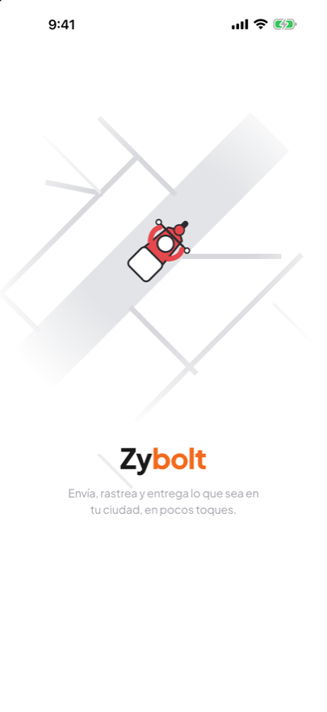
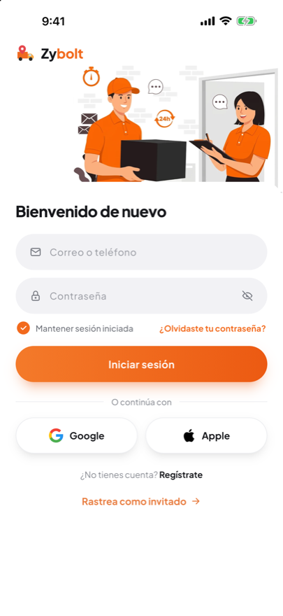
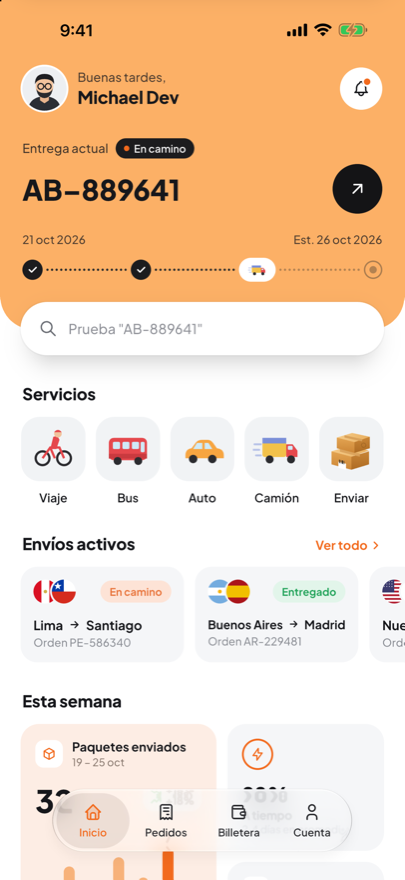
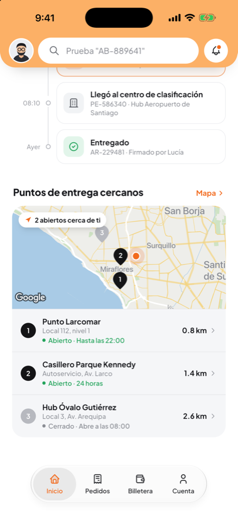
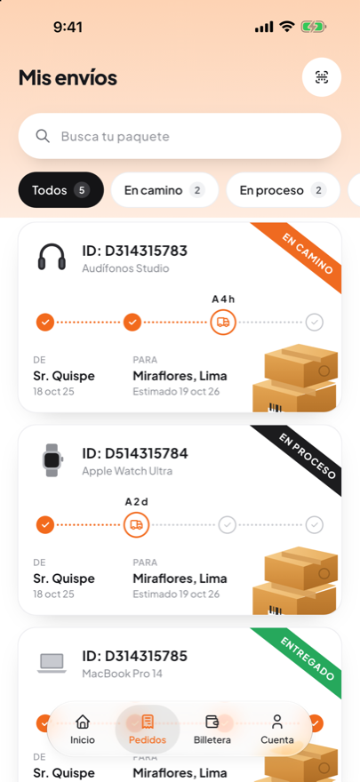
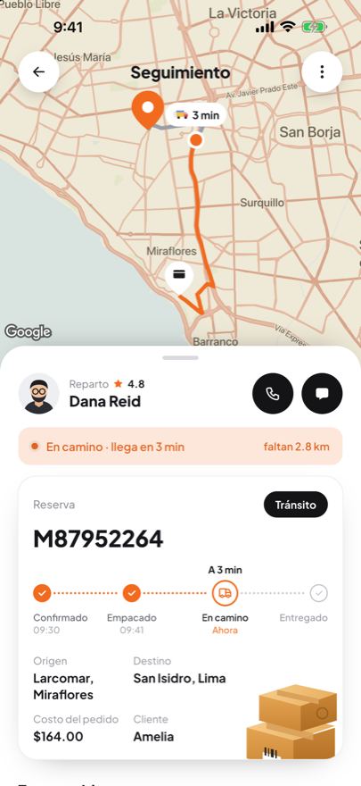
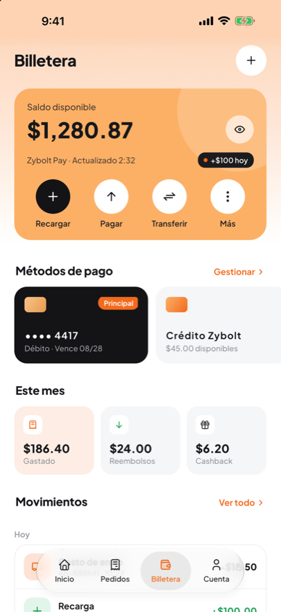
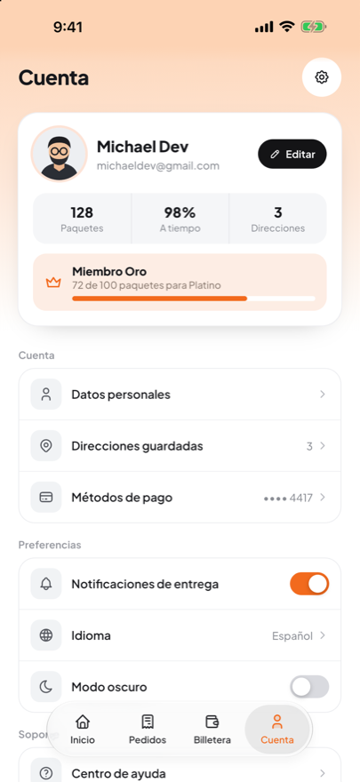

<div align="center">



# Zybolt

**Envía, rastrea y entrega lo que sea en tu ciudad, en pocos toques.**

App de envíos y seguimiento de paquetes en tiempo real, hecha con Flutter.

[](https://flutter.dev)
[](https://dart.dev)
[](https://bloclibrary.dev)
[](https://developers.google.com/maps)
[](https://pub.dev/packages/liquid_glass_widgets)
[](#)
[](#pruebas)
[](#pruebas)
[](LICENSE)

</div>

---

## Capturas

<table>
  <tr>
    <td align="center"><br/><sub><b>Splash</b></sub></td>
    <td align="center"><br/><sub><b>Inicio de sesión</b></sub></td>
    <td align="center"><br/><sub><b>Inicio</b></sub></td>
    <td align="center"><br/><sub><b>Puntos de entrega</b></sub></td>
  </tr>
  <tr>
    <td align="center"><br/><sub><b>Mis envíos</b></sub></td>
    <td align="center"><br/><sub><b>Seguimiento</b></sub></td>
    <td align="center"><br/><sub><b>Billetera</b></sub></td>
    <td align="center"><br/><sub><b>Cuenta</b></sub></td>
  </tr>
</table>

## Características

- **Seguimiento en vivo** sobre Google Maps: ruta real por calles de Lima, pines de tienda y cliente, repartidor en movimiento y burbuja con el tiempo estimado.
- **Hoja inferior arrastrable** con dos posiciones (mínima e intermedia); el mapa se reencuadra para mostrar toda la ruta en el espacio libre y, pasada la posición intermedia, el contenido se desplaza.
- **Reserva con línea de tiempo**: Confirmado → Empacado → En camino → Entregado, con la hora de cada paso.
- **Barra de navegación Liquid Glass** (iOS 26): al mantener presionado y arrastrar, el indicador de vidrio sigue al dedo.
- **Mis envíos** con filtros calculados, búsqueda con *debounce* de 250 ms y cintas de estado.
- **Inicio** con cabecera que se compacta al hacer scroll, esqueletos de carga, estadísticas semanales y puntos de entrega cercanos en Google Maps.
- **Billetera** con saldo ocultable, métodos de pago y movimientos agrupados por día.
- **Cuenta** con preferencias de cambio optimista (se revierte si falla) y cierre de sesión.
- Respeta *reducir movimiento* del sistema y cuenta con etiquetas de accesibilidad en los botones de solo ícono.

## Arquitectura

*Feature-first* con Clean Architecture ligera. Cada funcionalidad separa `domain`, `data` y `presentation`.

```
lib/
├── app/                 # router (go_router), inyección (get_it) y MaterialApp
├── core/
│   ├── theme/           # tokens: colores, tipografía, espaciado, sombras, duraciones
│   ├── widgets/         # componentes reutilizables
│   ├── config/          # configuración de Google Maps
│   └── utils/           # formateadores
└── features/
    ├── splash/  auth/  home/  shipments/  tracking/  wallet/  account/
```

| Patrón | Dónde |
|---|---|
| **BLoC / Cubit** | un bloc por pantalla con lógica; estados inmutables con `Equatable` |
| **Repository** | interfaz en `domain`, implementación falsa en `data` |
| **Use case** | `SignInUseCase`, `GetParcelsUseCase`, `WatchTrackingUseCase` |
| **Strategy** | `ParcelStatusStyle` decide cómo se pinta cada estado |
| **Factory** | `StepperNode.fromProgress` |
| **Observer** | el seguimiento es un `Stream` que consume el `TrackingBloc` |
| **Composite** | las secciones del Inicio se componen en una lista |

Ningún widget escribe un color, tamaño o duración sueltos: todo sale de `core/theme`.

## Tecnologías

| Área | Paquete |
|---|---|
| Estado | `flutter_bloc`, `bloc_concurrency`, `equatable` |
| Navegación | `go_router` |
| Inyección | `get_it` |
| Mapas | `google_maps_flutter` |
| UI | `liquid_glass_widgets`, `flutter_svg` |
| Configuración | `flutter_dotenv` |
| Pruebas | `bloc_test`, `mocktail` |

Tipografía: **Plus Jakarta Sans**, empaquetada en `assets/fonts/` (sin depender de internet).

## Empezar

### Requisitos

- Flutter **3.41** o superior (el proyecto lo fija con [FVM](https://fvm.app) en `.fvmrc`).
- Xcode (iOS) o Android Studio.
- Una clave de **Google Maps** con *Maps SDK for iOS/Android* habilitados.

### Instalación

```bash
git clone https://github.com/VMichael1999/zybolt.git
cd zybolt
fvm use            # o usa Flutter 3.41+ directamente
flutter pub get
```

### Clave de Google Maps

```bash
cp .env.example .env
# edita .env y completa EXPO_PUBLIC_GOOGLE_MAPS_API_KEY
./tool/sync_maps_key.sh   # copia la clave al xcconfig de iOS (ignorado por git)
```

Android lee el `.env` directamente desde Gradle. Si no hay clave, el seguimiento usa un mapa dibujado como alternativa.

> Restringe tu clave en Google Cloud (por app y por API) antes de publicar.

### Ejecutar

```bash
flutter run
```

## Pruebas

```bash
flutter analyze
flutter test
```

- **BLoC:** login (éxito, fallo, visibilidad), envíos (filtro, *debounce*, contadores), seguimiento (fases packed → transit → delivered), billetera (ocultar saldo, agrupación por día) y cuenta (cambio optimista con reversión, cierre de sesión).
- **Golden tests** a 440 × 956 de las pantallas y de cada componente reutilizable.

Para regenerar los goldens: `flutter test --update-goldens`.

## Datos de demostración

La app funciona con repositorios falsos: cualquier credencial inicia sesión como **Michael Dev** (`michaeldev@gmail.com`). La ruta de reparto (Larcomar, Miraflores → San Isidro, 6,8 km) se calculó una sola vez con la API Directions y está guardada en `route_data.dart`; el viaje se simula con un `Stream` (11 s de recorrido).

## Licencia

Distribuido bajo licencia MIT. Consulta [LICENSE](LICENSE).

---

<div align="center">Hecho con 🧡 por <a href="https://github.com/VMichael1999">@VMichael1999</a></div>
